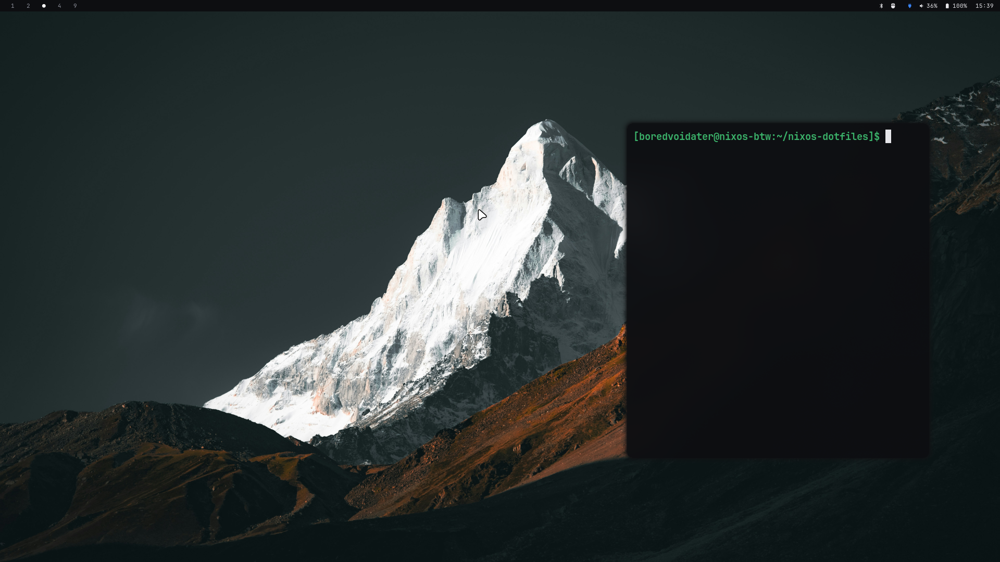
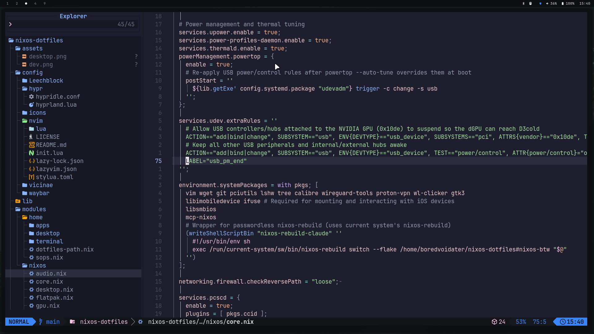
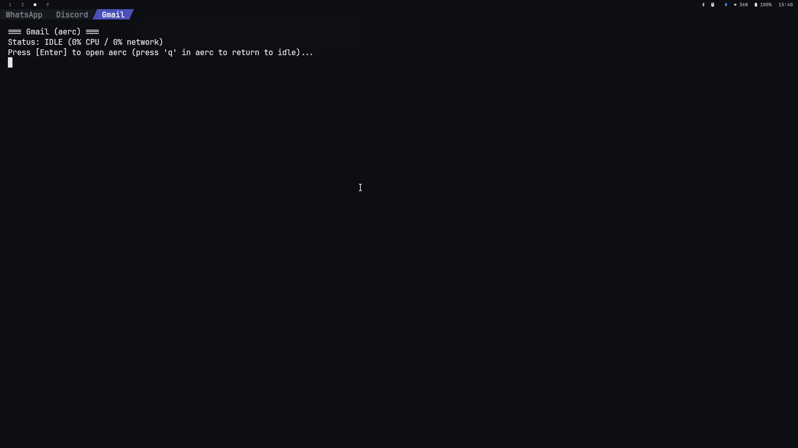
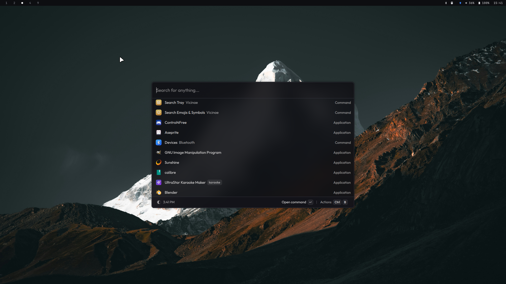

<div align="right">
  <a href="https://github.com/finn-degen-dev/nixos-dotfiles">English</a> · <b>Deutsch</b>
</div>
<div align="center">

# nixos-dotfiles

**Deklarative NixOS- + Hyprland-Workstation (Lua) für Host `nixos-btw`**  
Einheitliche Farbpalette · Kernel-/SSH-Hardening · Hybride Intel/NVIDIA-Power-States · CI-gecachte Builds

[](https://nixos.org/)
[](https://hyprland.org/)
[](./.sops.yaml)
[](./.github/workflows/maintenance.yml)

<br>



</div>

---

## Showcase

Alle Komponenten – Hyprland, Waybar, ReGreet, Kitty, Alacritty, Neovim (Catppuccin-Overrides), LibreWolf (`userChrome.css`), Mako, Zathura, `imv` und `ytm-player` – teilen sich eine zentrale Palette in [`lib/palette.nix`](lib/palette.nix) (`#0d0e11` Base, `#4c50bc` Akzent, `JetBrainsMono Nerd Font`).

<table>
  <tr>
    <td width="50%">
      
      <p align="center"><b>Dev-Workflow</b> — LazyVim + Catppuccin-Overrides, <code>csharp-ls</code>, <code>nil</code> und Unity-FHS-Bridge</p>
    </td>
    <td width="50%">
      
      <p align="center"><b>Comms-Scratchpad</b> — Kitty-Overlay mit gepatchtem <code>nchat</code> (WhatsApp), <code>concord</code> (Discord) und <code>aerc</code> (Gmail)</p>
    </td>
  </tr>
  <tr>
    <td width="50%">
      
      <p align="center"><b>Launcher & System-Menüs</b> — Vicinae-Skripte für Power-Profile, Multi-Monitor-Modi, OCR und QR-Scan</p>
    </td>
    <td width="50%">
      <p><b>Live-Reload-Konfiguration</b></p>
      <p>Konfigurationen unter <code>config/</code> (<code>hypr</code>, <code>waybar</code>, <code>vicinae</code>, <code>nvim</code>) sind per <code>mkOutOfStoreSymlink</code> verlinkt, sodass Änderungen sofort ohne Nix-Store-Rebuild greifen.</p>
    </td>
  </tr>
</table>

---

## System-Stack im Überblick

| Schicht | Umsetzung | Quelle |
| :--- | :--- | :--- |
| **Window Manager** | Hyprland 0.57+ in **Lua**, 3-Finger-Pinch-Resize, Scratchpad-Regeln | [`config/hypr/hyprland.lua`](config/hypr/hyprland.lua) |
| **Statusbar & Hardware** | Einheitlicher Python-Waybar-Daemon (BlueZ `busctl`, UPower, `sysfs`, USB/SD-Eject) | [`config/waybar/scripts/devices.py`](config/waybar/scripts/devices.py) |
| **GPU & Power** | Intel-iGPU-Wayland + NVIDIA-`D3cold`-Offload; 4-Modi-Power-State-Machine | [`modules/nixos/gpu.nix`](modules/nixos/gpu.nix) · [`power-mode.sh`](config/vicinae/scripts/power-mode.sh) |
| **Sicherheit & Secrets** | `nftables`, gehärtetes OpenSSH, striktes `sysctl`, `sops-nix` + `age` | [`modules/nixos/security.nix`](modules/nixos/security.nix) · [`.sops.yaml`](.sops.yaml) |
| **Browser & Webapps** | Minimales LibreWolf-CSS + Policy-Addons; isolierte Chrome-Webapps | [`modules/home/apps/librewolf.nix`](modules/home/apps/librewolf.nix) · [`webapps.nix`](modules/home/apps/webapps.nix) |
| **CI & Updates** | Wöchentliche GitHub Actions + Cachix für schwere Overlays (`nchat`, `concord`, `aseprite`) | [`maintenance.yml`](.github/workflows/maintenance.yml) · [`system-update.sh`](config/vicinae/scripts/system-update.sh) |

---

## Technische Details

### Sicherheit & Secret-Management
* **Netzwerk & SSH:** Zustandsbehaftete `nftables`-Firewall mit Paket-/Verbindungs-Logging; OpenSSH auf Public-Key-Auth beschränkt (`PermitRootLogin no`, AEAD/ETM-Chiffren, Forwarding deaktiviert).
* **Kernel-Hardening:** Strikte `sysctl`-Defaults (`rp_filter`, `tcp_syncookies`, `kptr_restrict=2`, `dmesg_restrict=1`, `yama.ptrace_scope=1`, `unprivileged_bpf_disabled=1`, `perf_event_paranoid=3`, `vm.mmap_rnd_bits=32`, geschützte Links/FIFOs) sowie Blacklist für Legacy-Dateisysteme (`cramfs`, `ecryptfs`, `hfs*`, `udf`).
* **Secrets ohne Store-Leak:** `secrets/secrets.yaml` ist mit `age` (`sops-nix`) verschlüsselt und wird bei Aktivierung sicher in Laufzeitdateien mit `0600`-Rechten gerendert (z. B. `gen-aerc-accounts.py` für Gmail).
* **Signierte Builds & enges `sudo`:** `require-sigs = true` aktiv; `@wheel` verlangt Passwortabfrage bis auf drei explizit begrenzte Kommandos (`smbios-battery-ctl`, `nix-env`, `nixos-rebuild-claude`).

### Hybride Intel/NVIDIA-GPU & Power-Management
* **iGPU-First-Desktop:** Hyprland läuft strikt auf `/dev/dri/intel-igpu` (`AQ_DRM_DEVICES`), sodass die NVIDIA-dGPU im Leerlauf in `D3cold` schläft und nur über einen eigenen `nvidia-offload`-Wrapper aktiviert wird (Unity, Blender, Kdenlive, OBS, Onshape WebGL).
* **Adaptive Power-Modi (`power-mode.sh`):** Wechselt bei Netzbetrieb und 100 % Akku automatisch in **Wall-Plugged** (Ladebegrenzung / `conservation_mode`) oder in **Power Saver** (60 Hz, Blur/Animationen aus, `no_turbo`, ungenutztes Bluetooth aus und `SIGUSR1`-Signal an Waybar zur Reduktion der Polling-Frequenz von 3–5 s auf 60 s).

### Eigene Workflows & Tools
* **Terminal-Kommunikation (`comms-scratchpad`):** Eigene C++/Go-Patches für `nchat` (Inline-Medien + `ffmpeg`→`opusenc`-Sprachnachrichten), `concord`, `aerc` sowie ein Hyprland-fähiger `imv`-Wrapper.
* **Offline-Sprachnotizen (`ramble`):** Mikrofonaufnahme + lokale Transkription via `whisper.cpp`, direkt in Zwischenablage und Neovim.
* **Smarte Updates (`update`):** Prüft lokal per `nix build --dry-run` und triggert GitHub Actions + Cachix nur dann, wenn schwere Custom-Overlays tatsächlich neu gebaut werden müssen.

---

<details>
<summary><b>Verzeichnisstruktur & Shell-Aliase</b></summary>

```text
.
├── flake.nix                  # Inputs, Custom-Overlays, nixosConfigurations.nixos-btw
├── configuration.nix          # NixOS-Systemkonfiguration
├── home.nix                   # Home-Manager-Einstiegspunkt
├── lib/                       # meta.nix & palette.nix
├── modules/
│   ├── nixos/                 # core, security, gpu, desktop, audio, flatpak, ios, icloud
│   └── home/                  # desktop, terminal, sops, apps (comms, karaoke, unity, etc.)
└── config/                    # hypr, nvim, vicinae, waybar (out-of-store verlinkt)
```

| Alias | Befehl |
| :--- | :--- |
| `nrs` | `sudo nixos-rebuild switch --flake ~/nixos-dotfiles#nixos-btw` |
| `update` | Flake-Update + bedingter GitHub/Cachix-Offload + Switch + 7-Tage-GC |
| `update-local` | Komplett lokales Flake-Update, Rebuild und Store-Optimierung |
| `sops-edit` | `secrets/secrets.yaml` mit `sops` bearbeiten |
| `unity` | `unityhub` über `nvidia-offload` starten |
| `pack` | Repository mit `repomix` bündeln |

</details>
