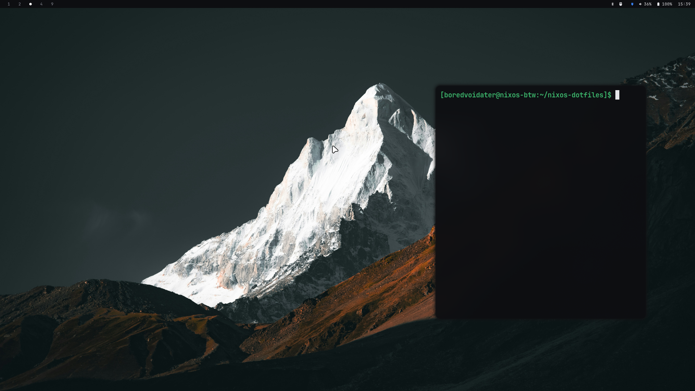
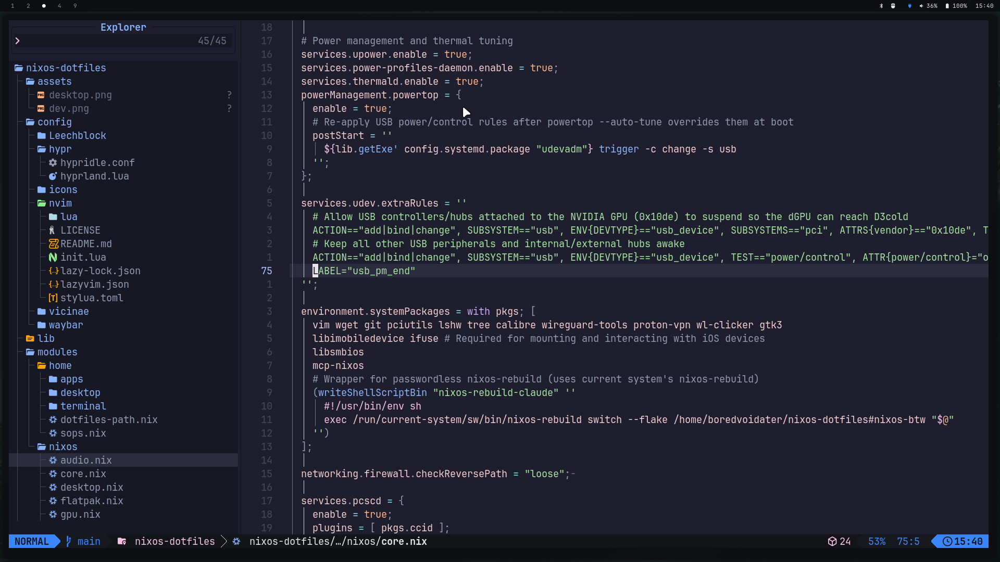
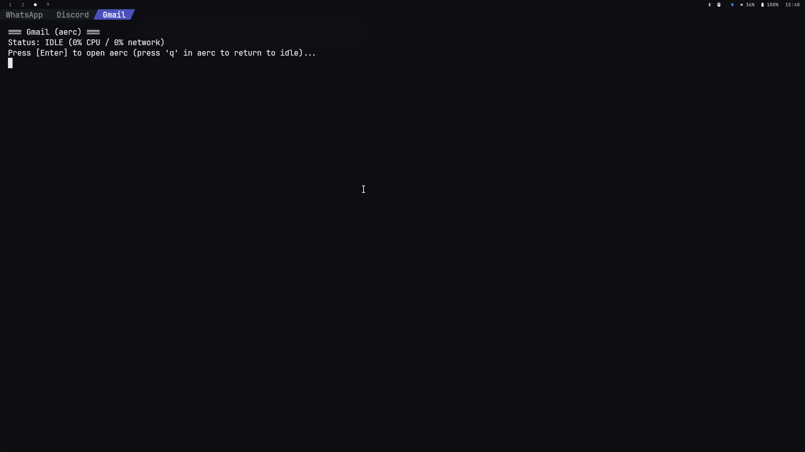
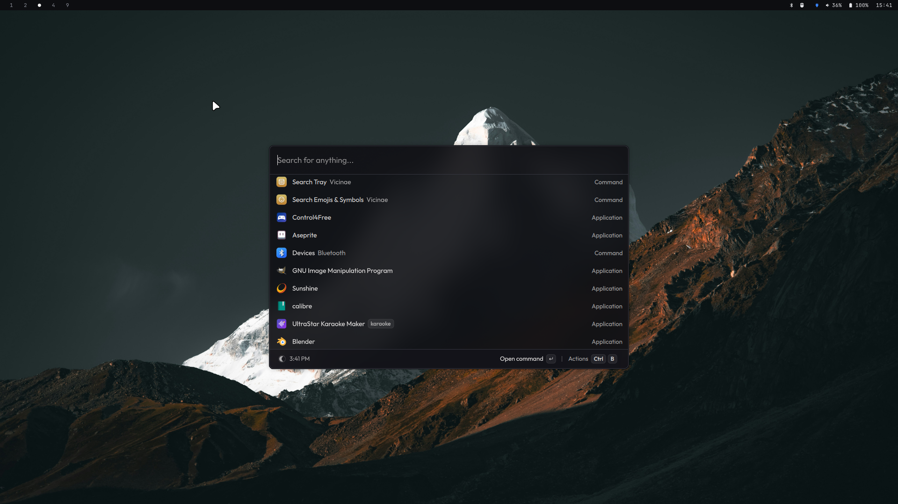

<div align="center">

# nixos-dotfiles

**Declarative NixOS + Hyprland (Lua) workstation for `nixos-btw`**  
Single-palette theming · Kernel/SSH hardening · Hybrid Intel/NVIDIA power states · CI-cached builds

[](https://nixos.org/)
[](https://hyprland.org/)
[](./.sops.yaml)
[](./.github/workflows/maintenance.yml)

<br>



</div>

---

## Showcase

All components—Hyprland, Waybar, ReGreet, Kitty, Alacritty, Neovim, LibreWolf (`userChrome.css`), Mako, Zathura, `imv`, and `ytm-player`—share one palette definition in [`lib/palette.nix`](lib/palette.nix) (`#0d0e11` base, `#4c50bc` accent, `JetBrainsMono Nerd Font`).

<table>
  <tr>
    <td width="50%">
      
      <p align="center"><b>Dev Workflow</b> — LazyVim + Catppuccin overrides, <code>csharp-ls</code>, <code>nil</code>, and Unity FHS bridge</p>
    </td>
    <td width="50%">
      
      <p align="center"><b>Comms Scratchpad</b> — Kitty overlay running patched <code>nchat</code> (WhatsApp), <code>concord</code> (Discord), and <code>aerc</code> (Gmail)</p>
    </td>
  </tr>
  <tr>
    <td width="50%">
      
      <p align="center"><b>Launcher & System Menus</b> — Vicinae scripts for power profiles, multi-monitor layouts, OCR, and QR scanning</p>
    </td>
    <td width="50%">
      <!-- Optional 4th screenshot (e.g. LibreWolf minimal CSS or Waybar Bluetooth/USB menu) -->
      <p><b>Live-Reloadable Configs</b></p>
      <p>Configs under <code>config/</code> (<code>hypr</code>, <code>waybar</code>, <code>vicinae</code>, <code>nvim</code>) use <code>mkOutOfStoreSymlink</code> so changes take effect immediately without rebuilding the Nix store.</p>
    </td>
  </tr>
</table>

---

## System Stack at a Glance

| Layer | Implementation | Source |
| :--- | :--- | :--- |
| **Window Manager** | Hyprland 0.57+ configured in **Lua**, 3-finger pinch resize, scratchpad rules | [`config/hypr/hyprland.lua`](config/hypr/hyprland.lua) |
| **Status Bar & Hardware** | Unified Python Waybar daemon (BlueZ `busctl`, UPower, `sysfs`, USB/SD eject) | [`config/waybar/scripts/devices.py`](config/waybar/scripts/devices.py) |
| **GPU & Power** | Intel iGPU Wayland + NVIDIA `D3cold` offload; 4-mode power state machine | [`modules/nixos/gpu.nix`](modules/nixos/gpu.nix) · [`power-mode.sh`](config/vicinae/scripts/power-mode.sh) |
| **Security & Secrets** | `nftables`, hardened OpenSSH, strict `sysctl`, `sops-nix` + `age` | [`modules/nixos/security.nix`](modules/nixos/security.nix) · [`.sops.yaml`](.sops.yaml) |
| **Browser & Webapps** | LibreWolf minimal CSS + policy-enforced addons; isolated Chrome webapps | [`modules/home/apps/librewolf.nix`](modules/home/apps/librewolf.nix) · [`webapps.nix`](modules/home/apps/webapps.nix) |
| **CI & Updates** | Weekly GitHub Actions + Cachix build for heavy overlays (`nchat`, `concord`, `aseprite`) | [`maintenance.yml`](.github/workflows/maintenance.yml) · [`system-update.sh`](config/vicinae/scripts/system-update.sh) |

---

## Engineering Highlights

### Security & Secret Management
* **Network & SSH:** Stateful `nftables` firewall with refused packet logging; OpenSSH locked to `publickey` auth (`PermitRootLogin no`, AEAD/ETM ciphers, forwarding disabled).
* **Kernel Hardening:** `rp_filter`, `tcp_syncookies`, `kptr_restrict=2`, `dmesg_restrict=1`, `yama.ptrace_scope=1`, `unprivileged_bpf_disabled=1`, `perf_event_paranoid=3`, `vm.mmap_rnd_bits=32`, protected links/FIFOs, and blacklisted legacy filesystems (`cramfs`, `ecryptfs`, `hfs*`, `udf`).
* **Zero-Store-Leak Secrets:** `secrets/secrets.yaml` is encrypted with `age` (`sops-nix`) and rendered to `0600` runtime configs on activation (e.g., `gen-aerc-accounts.py` for Gmail).
* **Signed Builds & Scoped `sudo`:** `require-sigs = true` enforced; `@wheel` requires passwords except three explicitly scoped commands (`smbios-battery-ctl`, `nix-env`, `nixos-rebuild-claude`).

### Hybrid Intel / NVIDIA & Power State Machine
* **iGPU-First Desktop:** Hyprland binds strictly to `/dev/dri/intel-igpu` (`AQ_DRM_DEVICES`) so the NVIDIA dGPU sleeps in `D3cold` until explicitly offloaded via a custom `nvidia-offload` wrapper (Unity, Blender, Kdenlive, OBS, Onshape WebGL).
* **Adaptive Power Modes (`power-mode.sh`):** Auto-switches to **Wall-Plugged** (charge threshold / `conservation_mode` bypass) on AC at 100%, or **Power Saver** (60 Hz panel, blur/animations off, `no_turbo`, idle Bluetooth off, and `SIGUSR1` wakeup slowing Waybar polling from 3–5 s to 60 s).

### Custom Workflows & Apps
* **Terminal Comms (`comms-scratchpad`):** Custom C++/Go patches on `nchat` (inline media + `ffmpeg`→`opusenc` voice messages), `concord`, `aerc`, and a Hyprland-aware `imv` wrapper that floats media inside the scratchpad.
* **Voice-to-Markdown (`ramble`):** Offline microphone transcription (`ffmpeg` + `whisper.cpp`) copied to clipboard and opened in Neovim.
* **Smart Updates (`update`):** Runs `nix build --dry-run` locally first—only dispatches GitHub Actions + Cachix when heavy custom overlays actually need recompiling.

---

<details>
<summary><b>Repository Structure & Common Aliases</b></summary>

```text
.
├── flake.nix                  # Inputs, custom overlays, nixosConfigurations.nixos-btw
├── configuration.nix          # System imports & host settings
├── home.nix                   # Home Manager imports
├── lib/                       # meta.nix & palette.nix
├── modules/
│   ├── nixos/                 # core, security, gpu, desktop, audio, flatpak, ios, icloud
│   └── home/                  # desktop, terminal, sops, apps (comms, karaoke, unity, etc.)
└── config/                    # hypr, nvim, vicinae, waybar (out-of-store symlinked)
